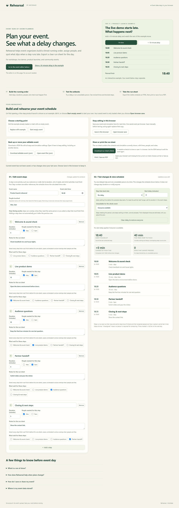

# Rehearsal

Arcdrake's local-first run-of-show editor for a single event. Build steps with durations, people and dependencies, simulate a setback, and export a standalone HTML run sheet that you can open in a browser to print or save as PDF.



[Mobile preview](docs/screenshots/mobile.png). Screenshots use synthetic examples.

## Run locally

Install Node.js 24 or newer. No runtime dependencies or package install
are required. From the repository root:

```sh
node scripts/serve.mjs
```

Open http://127.0.0.1:43147. Serve modules over HTTP(S), not `file://`.

```sh
node --test tests/*.test.mjs
node scripts/package.mjs
```

The package command assembles only static files and licence/notices in
`artifacts/release/`, with a SHA-256 manifest; it does not deploy. No compilation or
network download occurs. For browser checks, follow the locked development setup below and use `npm run test:ci`, which manages its preview server.

## Limits and data

One event and simulation can be saved locally per browser; use JSON download/import
for portable backups. Saving uses localStorage on the current origin; clearing browser
data removes it. Dependencies and shared people determine scheduling; unavailable
people apply to the whole simulation, not a time range. Independent steps may overlap.
Physical print output remains unverified.
There is no application backend or event upload.

Browser tests cover Chromium desktop and 390/320px layouts. Physical devices,
screen readers, Safari and Firefox have not been tested.

## Licence and feedback

[MIT](LICENSE), copyright 2026 Michael Eigner-Dietl. See
[third-party and asset notices](THIRD_PARTY_NOTICES.md). An
[Arcdrake](https://arcdrake.com/) product. Use synthetic examples when reporting
issues. Do not attach private data or unredacted personal images to public issues.
[Report a bug](https://github.com/ArcdrakeStudios/rehearsal/issues).

## Source, support and development

[Source](https://github.com/ArcdrakeStudios/rehearsal) · [Issues](https://github.com/ArcdrakeStudios/rehearsal/issues) · [Contributing](CONTRIBUTING.md) · [Security](SECURITY.md)

Part of Arcdrake's tools collection. The planned shared home is `tools.arcdrake.com`;
production hosting is not live as part of this source release. Local use is available
above. Development checks use Node.js 24 and locked Playwright tooling:

```sh
npm ci
npx playwright install chromium
npm test
npm run test:ci
npm run package:release
```

The CI wrapper starts and stops its own preview server. Runtime operation needs no
package installation. [Release procedure](docs/RELEASING.md).
